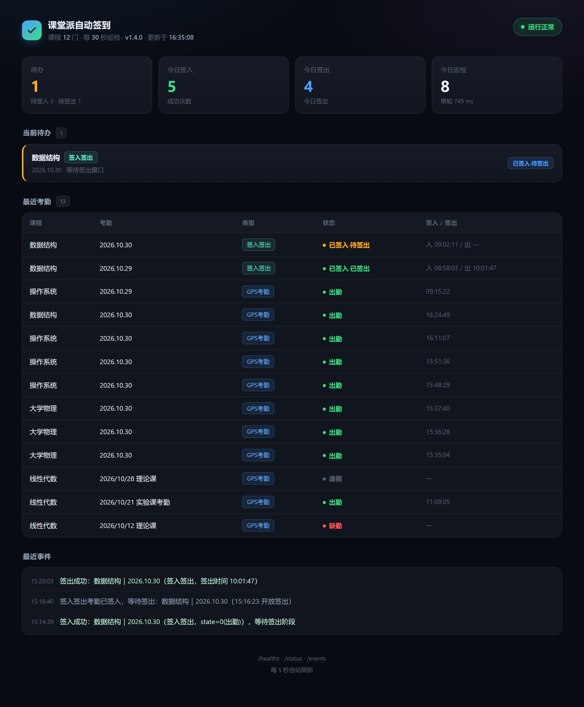

# ketangpai-auto-checkin

> Auto check-in for [Ketangpai](https://w.ketangpai.com) (课堂派) — the attendance system used by many Chinese universities.

<div align="center">
  
</div>

**What it does:** polls every course you're enrolled in every 10 seconds, and signs you in the moment a teacher opens attendance. Handles GPS / traditional / numeric-code / **check-in + check-out** attendance.

**Why this one:**

| | This project | Typical tools |
| --- | --- | --- |
| Check-in **and** check-out | Both, automatically | Check-in only |
| Runtime | Zero deps, plain Node | npm packages + Python env |
| Notifications | HTTP event stream, plug anything | Hardcoded Telegram bot |
| Deployment | Hand `agent/INSTALL.md` to an AI | You follow a README manually |

## Quick start

**Let an AI do it.** Paste this to any agent with server access (Claude Code, Cursor, Hermes, OpenClaw…):

```text
Deploy ketangpai-auto-checkin for me.
Read https://github.com/lin-hongkuan/ketangpai-auto-checkin/blob/main/agent/INSTALL.md
and follow it on my server.

My Ketangpai token: <paste token>
Server: <user>@<ip>
```

Get the token: log in at <https://w.ketangpai.com> → `F12` → Console →

```js
copy(localStorage.getItem('token') || localStorage.getItem('token_for_login'))
```

**Or by hand:**

```bash
git clone https://github.com/lin-hongkuan/ketangpai-auto-checkin.git
cd ketangpai-auto-checkin
cp .env.example .env && vi .env      # fill KTP_TOKEN
docker compose up -d --build
curl -s 127.0.0.1:18080/healthz
```

**Or without Docker:**

```bash
KTP_TOKEN=<token> DATA_DIR=./data PORT=18080 node src/index.mjs
```

## Dashboard

`http://127.0.0.1:18080/?token=<DASHBOARD_TOKEN>`

Shows pending items (separated into *to check in* / *to check out*), the last 20 attendance records with both timestamps, and a live event feed.

## Configuration

`data/config.json` (hot-reloaded, 30s):

```json
{
  "token": "",
  "latitude": "23.069389",
  "longitude": "113.389922",
  "coordsAreWgs84": false,
  "requireGpsCoords": false,
  "digitCode": ""
}
```

- Coordinates matter for GPS attendance. Priority: **real coords → empty → zero** as last resort.
- `requireGpsCoords: true` = strict mode: never sign GPS attendance without coordinates (avoids "shows present for you, absent for the teacher").
- `digitCode`: 4-digit code for numeric attendance, or submit it via `POST /code`.

## Event stream

```bash
curl 'http://127.0.0.1:18080/events?since=0&token=xxx'
```

Types: `signed`, `checkout_signed`, `need_code`, `need_scan`, `need_gps`, `failed`, `checkout_missed`, `sign_stuck`, `token_expired`, …

Ready-made consumers: [`integrations/webhook.mjs`](integrations/webhook.mjs) (Telegram / Feishu / DingTalk / WeCom) and [`integrations/hermes.py`](integrations/hermes.py).

> ⚠️ `seq` lives in memory and **resets to 1 on container restart**. If `lastSeq < your cursor`, re-read from `since=0` — otherwise you'll silently receive nothing.

## Docs

- [中文 README](README.md) — full documentation
- [agent/INSTALL.md](agent/INSTALL.md) — the AI deployment playbook
- [integrations/](integrations/README.md) — notification setup
- [CHANGELOG](CHANGELOG.md)

## Disclaimer

For automating **your own** account only. No multi-account signing, no bypassing authentication. Check your school's rules before using — you are responsible for how you use this.

MIT licensed.
